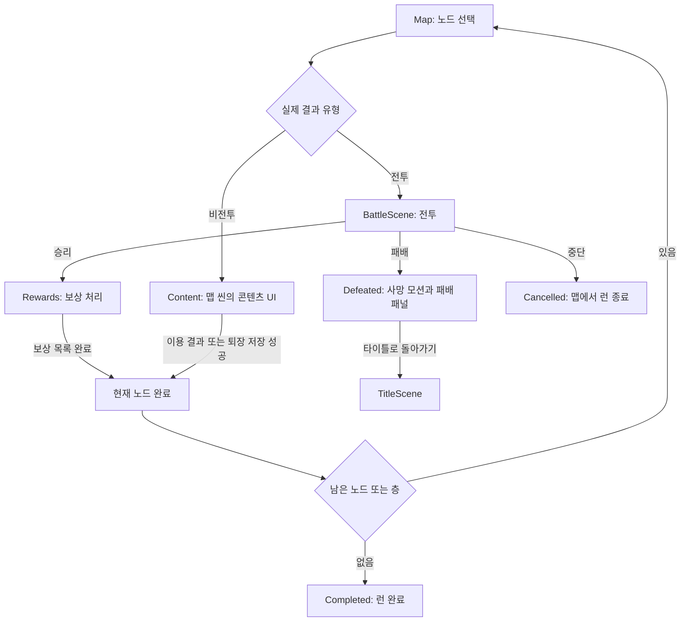

# 맵과 런 진행

2026-11-17 기준입니다. 강화 세부 설계는 [카드 강화 구현 설계](CardUpgrades.md)를 참고합니다.

## 구현 상태와 역할

타이틀에서 새 모험을 시작하면 1층 13노드를 진행합니다. 일반·엘리트·보스 전투, 상점의 카드 구매·제거, 휴식의 체력 회복·카드 강화, 미지 결과와 매개체 획득을 이용할 수 있습니다. 상점의 매개체 판매는 준비 중입니다.

| 구성 | 역할 | 소스 |
|---|---|---|
| `RunDefinition` | 씬 이름, 시작 HP·골드, 층 목록, 허용 콘텐츠 | [RunDefinition.cs](../Assets/Scripts/Map/RunDefinition.cs) |
| `FloorMapDefinition` | 노드 수, 생성 모드, 확률·가중치, 전투 풀과 콘텐츠 데이터 | [FloorMapDefinition.cs](../Assets/Scripts/Map/FloorMapDefinition.cs) |
| `MapGenerator` | 설정과 시드로 한 층의 노드·선택지 생성 | [MapGenerator.cs](../Assets/Scripts/Map/MapGenerator.cs) |
| `MapNode`, `MapChoice` | 노드 규칙·진행 상태와 선택지의 종류·데이터 | [MapNode.cs](../Assets/Scripts/Map/MapNode.cs) |
| `RunProgress` | 현재 층·노드·HP와 진행 단계, 완료 조건 관리 | [RunProgress.cs](../Assets/Scripts/Map/RunProgress.cs) |
| `RunSession` | 씬을 넘어 진행 상태 유지, 전투 이동, 완료 통지 | [RunSession.cs](../Assets/Scripts/Map/RunSession.cs) |
| `MapController` | 맵 UI 갱신, 선택 잠금, 콘텐츠 처리기 호출 | [MapController.cs](../Assets/Scripts/Map/MapController.cs) |
| `MapContentHandler` | 비전투 콘텐츠의 진입, 상태 저장·복원, 방문 검증 공통 계약 | [MapContentHandler.cs](../Assets/Scripts/Map/MapContentHandler.cs) |
| `ShopHandler`, `ShopStockSampler` | 상점 패널과 골드 표시, 슬롯 추첨과 복원, 퇴장 | [ShopHandler.cs](../Assets/Scripts/Map/ShopHandler.cs), [ShopStockSampler.cs](../Assets/Scripts/Map/ShopStockSampler.cs) |
| `RestHandler` | 휴식 패널, HP 표시, 회복·강화 입력 | [RestHandler.cs](../Assets/Scripts/Map/RestHandler.cs) |
| `RunBattleBridge` | 전투 시작 시 런 정보 적용, 결과·보상 완료 전달 | [RunBattleBridge.cs](../Assets/Scripts/Map/RunBattleBridge.cs) |

설정 ScriptableObject는 공유 정의이고, `RunProgress`의 노드 상태와 각 인벤토리가 현재 런의 실행 상태입니다. 상품 구매 여부나 이벤트 선택 결과를 공유 설정 에셋에 기록하지 않습니다.

## 현재 실행 구성

- 빌드 시작 씬은 `TitleScene`입니다. 군인으로 새 모험을 시작하면 [FirstFloorRun](../Assets/MapData/FirstFloorRun.asset)과 [FirstFloor](../Assets/MapData/FirstFloor.asset)를 사용해 `MapScene`으로 이동합니다.
- 활성 런 없이 `MapScene`을 직접 실행하면 [TemporaryRun](../Assets/MapData/TemporaryRun.asset)으로 5노드 맵을 엽니다. 2·5번의 미지, 3번의 상점·매개체, 4번의 휴식을 일반 전투와 함께 배치합니다.
- 13번 보스의 전투 보상 처리가 끝나면 맵에서 `런 완료`를 표시하고 선택지를 숨깁니다.
- 패배하면 전투 씬에서 사망 모션과 패배 패널을 표시합니다. 전투를 중단하면 맵에 런 종료 상태를 표시합니다.
- 군인의 새 모험은 최대 HP 80, 보유 골드 100, 시작 매개체 탄피로 시작합니다. 1층 전투의 골드 보상은 노드 시드로 정한 20~25에 현재 노드 번호(1부터 시작)를 더합니다. 첫 노드 보상은 21~26골드입니다. [전투 보상](BattleRewards.md)

## 규칙 조정

`FloorMapDefinition.mode`는 세 가지 모드를 제공합니다.

| 모드 | 규칙 |
|---|---|
| FirstFloor | 타이틀에서 시작하는 13노드 층입니다. `firstFloorLayout`에 노드별 역할을 지정하고 구간 전투 상한과 조우 풀을 적용합니다. |
| NormalBattlesOnly | `nodeCount`만큼 일반 전투를 배치하고 `fixedShopNodeNumber`, `fixedRestNodeNumber`, `fixedRelicNodeNumber`에 활성화된 비전투 선택지를 추가합니다. 위치는 1부터 세며 0은 비활성입니다. |
| PlannedFloor | 첫 일반 전투, 마지막 보스, 중간 특수 전투와 바로 다음 매개체를 예약한 후 나머지 일반 노드를 생성합니다. 최소 4개 노드가 필요합니다. |

`PlannedFloor`의 일반 노드는 일반 전투를 기본으로 생성합니다. 미지가 배치된 지점은 미지 선택지를 추가합니다. 나머지 일반 지점은 `nonBattleChance`와 `nonBattleContents`의 가중치에 따라 상점·매개체·이벤트·강화·휴식 중 하나를 추가할 수 있습니다. `eliteChance`는 엘리트 선택지를 독립적으로 추가합니다. 선택지는 최대 3개입니다.

중간 특수 노드는 `midpointMinRatio`와 `midpointMaxRatio`로 정한 중앙 구간에서 층마다 정확히 한 번 배치합니다. 시작·보스와 충돌하지 않도록 위치를 제한하고, 작은 층에서 비율 구간에 정수 위치가 없으면 가장 가까운 유효 위치를 사용합니다. 이 노드는 일반 전투와 엘리트 전투만 제공하며 어느 쪽을 선택해도 다음 노드는 매개체 하나만 제공합니다. 일반 노드의 확률적 엘리트 선택지는 확정 매개체 규칙과 관계없습니다.

`RunDefinition.floors` 배열의 순서대로 층을 진행합니다. 마지막 노드의 콘텐츠와 보상이 완료되어야 다음 층으로 이동하며, 마지막 층이면 런이 완료됩니다. 층 진입 시 한 번 생성한 결과는 씬을 왕복해도 다시 추첨하지 않습니다. 맵 생성에는 전투·카드 보상과 분리된 `System.Random` 시드를 사용합니다.

### 1층 노드 배치와 전투 상한

| 노드 | 선택지 |
|---|---|
| 1 | 일반 전투 1개 |
| 2·3·5·8·9·11 | 일반 전투 1개와 비전투 1개(70%) 또는 2개(30%). 구간 상한에 도달하면 비전투 2개 |
| 4·10 | 엘리트 전투 1개, 일반 전투 1개, 비전투 1개 |
| 6 | 엘리트 전투와 일반 전투 중 하나 |
| 7 | 매개체 1개를 발견하고 획득하거나 지나가기 |
| 12 | 휴식 1개와 미지·상점 중 1개를 40:30 가중치로 추첨 |
| 13 | 보스 전투 1개 |

일반 구간과 4·10번의 비전투 선택지는 미지·상점·휴식을 40:30:30으로 추첨합니다. 같은 노드에서 두 개를 뽑을 때는 먼저 뽑은 유형을 후보에서 제외합니다. 1~5번과 8~12번은 각각 완료한 전투를 최대 4회까지 허용합니다. 일반·엘리트와 미지에서 나온 일반 전투를 집계하며, 6번과 13번은 구간 집계에서 제외합니다. 층 전체에서 가능한 전투는 최대 10회입니다. 상한에 도달하면 5번은 비전투 선택지만 표시하며, 12번은 휴식과 추첨 선택지를 유지합니다. 두 노드의 미지에서 전투가 차단되면 전투 가중치를 이벤트로 넘깁니다.

### 조우 순서

층 입장 시 런 시드로 전반부 일반, 후반부 일반, 엘리트 풀을 각각 섞고 보스 조우를 확정합니다. 일반 조우는 해당 구간에서 일반 전투에 들어갈 때 순서대로 사용합니다. 6번 일반 전투와 8~12번의 일반 전투는 같은 후반부 순서를 따르며, 미지의 일반 전투도 해당 구간의 순서를 사용합니다. 풀을 다 쓰면 섞인 순서의 처음부터 반복합니다. 엘리트 선택지를 건너뛰면 엘리트 순서는 유지됩니다.

| 조우 풀 | 등록된 적 |
|---|---|
| 전반부 일반 (1~5번) | 슬라임, 도마뱀, 접힌 종이병정, 등불 나방 |
| 후반부 일반 (6번 및 8~12번) | 재봉거미, 허수아비, 움직이는 빗자루, 잉크 까마귀, 침대 시트 유령 |
| 엘리트 (4·6·10번) | 양철 나무꾼, 깨진 종, 뒤집힌 모래시계 |
| 보스 (13번) | 허수아비 |

전반부 일반 4종과 후반부 일반 5종은 각 풀의 최대 사용 횟수를 채우므로 1층 새 런에서 같은 일반 적이 반복되지 않습니다. 현재 조우는 공용 테스트 행동을 사용합니다. 1층의 엘리트·미지·7번 노드는 등급별 공용 매개체 목록에서 보상을 가져옵니다. 기존 런의 이어서 하기는 저장한 조우와 풀 순서를 사용합니다. [1층 에셋](../Assets/MapData/FirstFloor.asset) · [전투 보상](BattleRewards.md)

## 노드 선택부터 완료까지

- 선택 전 노드는 `Pending`이며, 선택하면 `Resolving`이 되어 다른 선택을 막습니다. 미지를 선택하면 실제 결과를 확정해 원래 선택지와 함께 저장합니다.
- 전투는 `Battle → Rewards`를 거칩니다. 카드 선택 후 확인 버튼을 누르는 것은 카드 지급 단계이고, 보상 목록에서 완료하거나 남은 보상을 포기해야 노드가 완료됩니다.
- 비전투는 `Content` 상태에서 처리합니다. 상점은 `상점 나가기`, 휴식은 `체력 회복` 또는 `강화하기`, 이벤트와 매개체는 보상 획득 또는 `지나가기`가 저장되면 현재 노드를 완료합니다.
- 완료된 노드는 `Completed`가 됩니다. 마지막 노드라면 다음 층을 생성하거나 런을 종료합니다.

## 휴식

휴식 패널은 현재 HP와 최대 HP, 카드 강화와 체력 회복 버튼을 표시합니다. `카드 강화`를 선택하면 강화할 수 있는 카드만 꿈·악몽별로 표시합니다. 선택한 카드의 강화 전후를 확인한 뒤 `강화하기`를 누르면 비용 없이 한 장을 교체하고 휴식을 마칩니다. 취소하면 비교 화면에서 목록으로, 목록에서 휴식 패널로 돌아갑니다. [강화 흐름](CardUpgrades.md#강화-ui와-노드-연결)을 참고합니다.

체력 회복을 누르기 직전의 `최대 HP - 현재 HP`를 기준으로 30%를 계산합니다. 이 값을 정수로 올림하고 10을 더해 최대 HP까지 회복합니다. 예를 들어 59/80에서는 17을 회복해 76/80이 됩니다. 이미 최대 HP면 체력 변화 없이 휴식을 마칩니다. 비율과 고정 회복량은 `RestHandler`의 Inspector에서 조정할 수 있습니다.

[여행자의 물통](../Assets/MapData/TravelersCanteen.asset)을 보유하면 체력 회복을 선택했을 때 고정 회복량이 10 증가합니다. 기본 설정에서는 잃은 체력의 30%를 올림한 값에 20을 더해 최대 HP까지 회복합니다.

회복과 노드 완료는 함께 저장합니다. 저장에 실패하면 기존 HP와 휴식 패널을 유지하고, 이어서 하기에서 휴식 입장 상태를 복원하면 저장된 HP를 표시합니다.

## 콘텐츠의 연결 경계

콘텐츠가 준비되면 `MapContentHandler`를 상속하는 컴포넌트를 맵 씬에 배치하고 `MapController.contentHandlers`에 연결합니다. `ContentType`은 처리하는 종류이며, `Begin(choice, progress, complete)`에서 화면을 엽니다. 일반 완료 콜백 `complete`는 저장 성공 시 `true`를 반환합니다. 휴식의 체력 회복처럼 자원과 진행을 동시에 바꾸는 동작은 전용 처리로 함께 저장합니다. 콜백에는 런 객체·층·노드가 묶여 있어 오래된 콜백으로 다음 노드나 새 런을 완료할 수 없습니다. `choice.ContentData`로 콘텐츠별 ScriptableObject를 전달할 수 있습니다.

생성 대상은 `RunDefinition.enabledContent`와 실제 사용 가능한 처리기의 교집합입니다. 전투 3종과 미지 선택은 기본 처리합니다. 비전투 결과는 등록된 활성 처리기가 필요합니다. 필수 매개체 처리기가 없는 계획형 층은 런 시작 시 거부합니다. 일반 노드의 미지원 선택지는 생성하지 않습니다. 진행 중 처리기가 비활성화된 경우 해당 선택지는 비활성 상태로 표시됩니다.

계획형 층은 일반·엘리트·보스 전투 풀이 모두 필요합니다. 필수 전투 풀이 비었거나 HP·확률·가중치 설정이 잘못되면 다른 콘텐츠로 대체하지 않고 설정 오류로 알립니다.

## 상점

상점 패널은 왼쪽에 꿈속 상인과 이미지가 적용된 `상점 나가기` 버튼을, 오른쪽에 상품 진열대를 표시합니다. 진열 카드 아래 왼쪽은 매개체 `입고 예정`, 오른쪽은 현재 가격을 표시하는 `카드 제거` 버튼입니다. 카드 가격은 각 진열 카드 아래 금화 아이콘과 함께 표시합니다. 카드 상세보기에서 `구매`를 누르면 잔액을 확인합니다. 보유 골드가 표시 가격 이상이면 그 가격만큼 차감하고 카드 한 장을 종류에 맞는 런 덱에 추가합니다. 부족하면 상세보기에서 안내하며 골드·덱·진열을 유지합니다. 저장에 실패하면 거래를 되돌리고 상세보기에서 다시 시도할 수 있습니다. 구매한 슬롯은 카드와 가격표를 숨기고 `SOLD OUT` 표지를 표시합니다.

보유 골드는 상단 덱·옵션 버튼 왼쪽에 표시합니다. 골드 아이콘은 문구와 한 줄로 배치해 금액의 자릿수가 바뀌어도 간격을 유지합니다. 덱·옵션 창은 상점 위에서 열리며, 닫으면 상점으로 돌아옵니다. `상점 나가기`는 저장이 성공하면 다음 지점으로 이동하고, 실패하면 패널을 유지합니다.

### 상점 카드 진열

상점은 전투 보상과 같은 `BattleRewardPools` 에셋의 카드 데이터베이스를 사용합니다. 각 슬롯은 아래 분류를 먼저 뽑고 해당 분류에서 카드를 균등하게 고릅니다.

| 슬롯 | 분류별 확률 |
|---|---|
| 꿈 1·2번, 악몽 1번 | 일반 공격, 일반 스킬, 고급 공격, 고급 스킬 각각 25% |
| 꿈 3번, 악몽 2번 | 고급 공격, 고급 스킬, 희귀 공격, 희귀 스킬, 희귀 지속 각각 20% |

일반 카드는 30~40골드, 고급 카드는 60~70골드, 희귀 카드는 90~110골드에서 양 끝을 포함해 균등하게 가격을 뽑습니다. 복원한 진열과 노드 시드로 같은 가격을 재현합니다. 품절 슬롯도 가격 계산 순서에 포함해 다른 슬롯의 가격을 유지합니다.

[상인 조합 증표](../Assets/MapData/MerchantGuildToken.asset)를 보유하면 카드 구매와 제거의 최종 가격을 30% 할인합니다. 소수점 이하는 버리며, 진열대·확인창과 골드 차감에 같은 가격을 사용합니다. 제거 기본가 100·150·200골드는 각각 70·105·140골드가 됩니다.

이미 진열한 카드는 같은 방문에서 다시 뽑지 않습니다. 후보가 없는 분류는 제외하고 남은 분류끼리 같은 확률로 뽑습니다. 현재 꿈 3칸을 사용하며, 악몽 데이터베이스가 비어 있어 악몽 2칸 대신 `입고 예정`을 표시합니다. 진열 카드는 슬롯 순서와 품절 여부를 저장하고 이어서 하기에서 복원합니다. 품절 표지는 입력을 받지 않습니다. 적용 이미지는 [shop-sold-out.png](../Assets/Images/UI/MapScene/shop-sold-out.png), 원본은 [768×240 투명 PNG](../GeneratedArt/UI/ShopSoldOut-v1/shop-sold-out.png)입니다. `DeckCard` 프리팹 인스턴스의 카드는 마우스를 올리면 확대되고, 좌클릭하면 카드 효과와 상태이상 설명을 확인할 수 있습니다.

### 상점 카드 제거

`카드 제거`를 누르면 현재 보유한 꿈·악몽 덱이 열립니다. 카드 한 장을 고른 뒤 상세보기에서 `100골드로 제거`처럼 표시된 버튼을 눌러 확정합니다. 제거 기본가는 100골드에서 시작해 같은 런에서 제거를 확정할 때마다 50골드씩 오릅니다. 실제 가격에는 보유 매개체의 할인을 적용합니다. 잔액이 부족하면 상세보기에서 안내합니다.

확정 시 현재 방문과 선택한 덱 항목을 다시 검증합니다. 같은 카드가 여러 장 있어도 선택한 항목 한 장만 제거합니다. 골드와 덱, 누적 제거 횟수를 함께 저장하며, 실패하면 세 상태를 복구해 상세보기에서 다시 시도할 수 있습니다. 성공 후에는 갱신된 가격을 표시하고, `상점 나가기`를 확정하면 다음 지점으로 진행합니다. [노드 체크포인트](RunCheckpoints.md#비전투-노드-연결)

## 미지 노드

`FirstFloor`에서는 비전투 선택지를 추첨할 때 미지 카드가 나올 수 있습니다. `NormalBattlesOnly`와 `PlannedFloor`에서는 `FloorMapDefinition.unknown.nodeNumbers`에 1부터 세는 위치를 지정합니다. 미지 결과의 기본 가중치는 일반 전투 40, 이벤트 40, 상점 9, 휴식 9, 매개체 2입니다. 이벤트 유형이 뽑히면 같은 층의 `unknown.events`에서 균등 추첨합니다. 이벤트는 한 층에서 다시 나올 수 있습니다. 매개체가 뽑히면 1층에서는 일반 70%·고급 30%로 등급을 정해 공용 목록의 다음 후보를 제시합니다. 두 등급 모두 제시할 후보가 없으면 매개체 결과를 제외합니다.

`battleLimits`에는 구간의 시작·끝 노드 번호와 전투 상한을 지정합니다. 완료한 일반·엘리트 전투를 세며 미지에서 확정된 일반 전투도 포함합니다. 중간 특수 전투와 보스는 구간의 집계에서 제외합니다. 상한에 도달하면 직접 전투 선택지를 숨기고, 미지의 전투 가중치를 이벤트에 더합니다. 결과 후보가 모두 준비된 경우 40·40·9·9·2가 0·80·9·9·2가 됩니다. 상한에 도달할 수 있는 지점에는 비전투 선택지가 필요하며, 차단된 전투 가중치를 받을 이벤트 풀이 비어 있으면 설정 오류로 처리합니다.

현재 이벤트인 잊힌 주머니와 메마른 우물에서는 골드를 받거나 지나갈 수 있습니다. 미다스의 손을 보유하면 표시 금액과 지급액이 50% 늘어나며 소수점 이하는 버립니다. [미지 카드](../Assets/Images/UI/NodeIcons/unknown-node.png) · [노드 체크포인트](RunCheckpoints.md#비전투-노드-연결)

## 매개체 노드

1층 7번의 매개체(Conduit) 카드에는 청동 고리를 표시합니다. 입장하면 기존 맵 위에 발견한 매개체 한 개의 그림, 이름, 등급, 효과를 보여 줍니다. 6번에서 일반 전투를 이기면 일반 등급, 엘리트를 이기면 고급 등급을 7번에 제시합니다. 4·6·10번 엘리트의 직접 매개체 보상은 전투 보상 처리를 마칠 때 지급합니다. [청동 고리 아트워크](../Assets/Images/UI/NodeIcons/conduit-node.png) · [전투 보상](BattleRewards.md)

`매개체 획득`은 보유 목록에 추가하면서 노드를 완료합니다. `지나가기`는 획득 없이 노드를 완료합니다. 이미 보유한 매개체를 다시 발견하면 보유 상태를 안내하고 지나갈 수 있습니다. 진입 시 저장한 매개체는 이어서 하기에서도 동일하게 표시됩니다. 미지에서 나온 매개체도 같은 화면을 사용합니다. [노드 체크포인트](RunCheckpoints.md#비전투-노드-연결)

1층 진입 시 일반·고급 목록을 시드로 각각 한 번 섞습니다. 엘리트 보상과 미지의 매개체 결과는 기본적으로 일반 70%·고급 30%로 정한 등급에서 다음 후보를 가져옵니다. [정예 사냥꾼의 훈장](../Assets/MapData/EliteHunterMedal.asset)을 보유하면 엘리트 보상에 일반 50%·고급 50%를 적용합니다. 추첨한 등급의 후보가 없으면 다른 등급을 사용합니다. 앞서 획득했거나 제시된 매개체는 이후 추첨에서 제외합니다.

7번 보상을 위해 6번 전투 결과가 정해지기 전까지 등급마다 마지막 한 종을 남겨 둡니다. 6번 엘리트를 이기면 직접 보상부터 계산하되, 7번에 줄 고급 한 종을 남깁니다. 6번 일반 전투를 이기면 7번 보상은 일반, 엘리트를 이기면 고급으로 확정합니다. 7번을 지나면 남은 후보를 다른 보상에 사용할 수 있습니다.

타이틀에서 시작하는 모험에는 군인의 시작 매개체 탄피와 공용 보상 후보 일반 7종·고급 7종이 있습니다. 예시용 확장 탄창과 미사용 적 전리품 에셋은 현재 공용 보상 목록에서 제외합니다.

| 구분 | 매개체 | 효과 |
|---|---|---|
| 시작 | [탄피](../Assets/MapData/SoldierStartingCasing.asset) | 전투 시작 시 탄창 한도 내에서 2발 장전 |
| 일반 | [접이식 엄폐판](../Assets/MapData/FoldingCover.asset) | 첫 플레이어 턴 시작 시 방어도 10 |
| 일반 | [가시 덤불](../Assets/MapData/ThornThicket.asset) | 전투 시작 시 전투 종료까지 지속되는 가시 3 |
| 일반 | [악몽의 책갈피](../Assets/MapData/NightmareBookmark.asset) | 악몽 손패 한도 1장 증가 |
| 일반 | [약점 각인기](../Assets/MapData/WeaknessEngraver.asset) | 카드가 적에게 부여하는 턴제 약점 노출 1턴 연장 |
| 일반 | [정예 사냥꾼의 훈장](../Assets/MapData/EliteHunterMedal.asset) | 엘리트 매개체 보상 등급 추첨을 일반 50%·고급 50%로 변경 |
| 일반 | [응급 붕대](../Assets/MapData/EmergencyBandage.asset) | 전투 승리 확정 시 체력 4 회복 |
| 일반 | [여행자의 물통](../Assets/MapData/TravelersCanteen.asset) | 휴식에서 체력 회복 선택 시 10 추가 회복 |
| 고급 | [자동 장전기](../Assets/MapData/AutomaticLoader.asset) | 첫 턴을 포함해 매 플레이어 턴 시작 시 탄창 한도 내에서 1발 장전 |
| 고급 | [방호막 발생기](../Assets/MapData/BarrierGenerator.asset) | 전투 시작 시 방호막 1 |
| 고급 | [방청유](../Assets/MapData/AntiRustOil.asset) | 보유한 런 동안 녹슬음 면역 |
| 고급 | [꿈의 책갈피](../Assets/MapData/DreamBookmark.asset) | 꿈 손패 한도 1장 증가 |
| 고급 | [상인 조합 증표](../Assets/MapData/MerchantGuildToken.asset) | 상점의 카드 구매와 제거 가격 30% 할인 |
| 고급 | [반달의 잔](../Assets/MapData/HalfMoonChalice.asset) | 전투 시작 시 꿈 게이지를 최대치의 절반까지 채움. 홀수 최대치는 내림 |
| 고급 | [미다스의 손](../Assets/MapData/MidasHand.asset) | 전투와 이벤트의 골드 획득량 50% 증가 |

`NormalBattlesOnly`에서는 `fixedRelicNodeNumber`와 `guaranteedRelicData`로 임시 배치를 설정합니다. `PlannedFloor`의 중간 특수 전투 다음 매개체도 `guaranteedRelicData`를 사용합니다.

### 매개체 추가

Unity Project 창에서 **Create → Conduit → Ammo Capacity**를 선택하고 이름·설명·스프라이트·등급과 효과를 설정합니다. `Rarity`는 표시와 보상 추첨에 사용하는 등급입니다. [FirstFloor.asset](../Assets/MapData/FirstFloor.asset)은 [일반 매개체 데이터베이스](../Assets/MapData/CommonConduitRewards.asset)와 [고급 매개체 데이터베이스](../Assets/MapData/UncommonConduitRewards.asset)를 참조합니다. 이 두 에셋의 `Conduits`에 등급이 맞는 보상 후보를 등록합니다. `ProjectDN → Refresh Run Save Catalog`에서 저장 카탈로그를 수동으로 갱신할 수 있습니다.

지원하는 효과는 탄약 한도와 장전, 전투 시작 버프·방어도·꿈 게이지, 손패 한도, 상태 부여 보정·면역, 승리·휴식 회복, 골드 보너스와 상점 할인, 엘리트 보상 등급 확률 보정입니다. 군인의 시작 매개체인 [탄피](../Assets/MapData/SoldierStartingCasing.asset)는 전투 시작 시 최대 탄약 한도 안에서 총알 2발을 장전합니다. [가시 덤불](../Assets/MapData/ThornThicket.asset)은 보유 중인 플레이어에게 전투를 시작할 때마다 가시 3을 부여합니다. 전투 시작 버프는 에셋의 `Battle Start Buff`와 `Battle Start Buff Power`에 설정합니다. 전투 종료까지 유지되는 버프와 다음 공격을 막으면 소모되는 방호막을 설정할 수 있습니다. 가시 덤불은 전용 아이콘과 함께 일반 공용 보상 후보에 등록되어 있습니다. [가시 덤불 아이콘](../Assets/Images/UI/Conduits/thorn-thicket.png) · [체크포인트 저장 규칙](RunCheckpoints.md#1층-조우와-매개체-복원)

고급 매개체 [자동 장전기](../Assets/MapData/AutomaticLoader.asset)는 1층 공용 보상 후보입니다. 첫 플레이어 턴을 포함해 플레이어 턴이 시작될 때마다 탄창 한도 내에서 총알을 1발 장전합니다. [자동 장전기 아이콘](../Assets/Images/UI/Conduits/automatic-loader.png)

고급 매개체 [방호막 발생기](../Assets/MapData/BarrierGenerator.asset)는 1층 공용 보상 후보입니다. 전투 시작 시 방호막을 1 얻습니다. 방호막은 다음에 받는 공격 피해를 막고 소모됩니다. [방호막 발생기 아이콘](../Assets/Images/UI/Conduits/barrier-generator.png)

일반 매개체 [접이식 엄폐판](../Assets/MapData/FoldingCover.asset)은 1층 공용 보상 후보입니다. 전투마다 첫 플레이어 턴 시작 시 방어도를 10 얻습니다. [접이식 엄폐판 아이콘](../Assets/Images/UI/Conduits/folding-cover.png)

고급 매개체 [방청유](../Assets/MapData/AntiRustOil.asset)는 1층 공용 보상 후보입니다. 획득하면 해당 런의 남은 전투에서 녹슬음에 면역이 됩니다. [방청유 아이콘](../Assets/Images/UI/Conduits/anti-rust-oil.png)

고급 매개체 [꿈의 책갈피](../Assets/MapData/DreamBookmark.asset)는 1층 공용 보상 후보입니다. 꿈 손패의 최대 장수를 1장 늘립니다. 시작 손패와 턴마다 다시 뽑거나 보충할 때 늘어난 한도를 사용합니다. [꿈의 책갈피 아이콘](../Assets/Images/UI/Conduits/dream-bookmark.png)

일반 매개체 [악몽의 책갈피](../Assets/MapData/NightmareBookmark.asset)는 1층 공용 보상 후보입니다. 시작 손패와 이후 드로우에 적용되는 악몽 손패 한도를 1장 늘립니다. [악몽의 책갈피 아이콘](../Assets/Images/UI/Conduits/nightmare-bookmark.png)

고급 매개체 [반달의 잔](../Assets/MapData/HalfMoonChalice.asset)은 전투 시작 시 꿈 게이지를 최대치의 절반까지 채웁니다. 최대치가 홀수이면 소수점 이하는 버립니다. [반달의 잔 아이콘](../Assets/Images/UI/Conduits/half-moon-chalice.png)

고급 매개체 [미다스의 손](../Assets/MapData/MidasHand.asset)은 전투 승리와 이벤트의 골드 획득량을 50% 늘립니다. 골드가 정수이므로 소수점 이하는 버립니다. [미다스의 손 아이콘](../Assets/Images/UI/Conduits/midas-hand.png)

일반 매개체 [응급 붕대](../Assets/MapData/EmergencyBandage.asset)는 전투 승리가 확정될 때 최대 체력 한도 내에서 체력을 4 회복합니다. [응급 붕대 아이콘](../Assets/Images/UI/Conduits/emergency-bandage.png)

### 매개체 아트워크 제작 기준

신규 매개체 아트워크는 투명 배경으로 제작합니다. 최근 원본은 `GeneratedArt/Conduits/`에 1254×1254 PNG로 두고, [게임용 이미지](../Assets/Images/UI/Conduits)는 Unity에서 최대 크기 256의 단일 Sprite로 임포트합니다. 물건의 비율을 유지하고 투명 여백으로 다른 아이콘과 표시 크기를 맞춥니다.

`BattleScene`의 `Canvas/ConduitArea`에 매개체를 왼쪽부터 획득 순서대로 표시합니다. 군인의 시작 매개체인 탄피가 먼저 표시되고 새로 획득한 매개체는 오른쪽에 추가됩니다. 획득 순서대로 저장한 보유 목록을 이어서 하기에서 그대로 복원합니다.

획득 패널과 HUD에 같은 투명 스프라이트를 사용하려면 매개체 에셋의 `Artwork`에 연결합니다. 획득 패널에 별도 아트를 사용하는 경우에는 `Hud Artwork`에 투명 아이콘을 연결합니다.

| 항목 | 1920×1080 기준 |
|---|---|
| 아이콘 슬롯 | 64×64px |
| 실제 그림의 긴 변 | 52~56px |
| 왼쪽 여백 | 24px |
| 슬롯 간격 | 12px |
| 정렬 | 왼쪽부터 배치하고 세로 중앙에 정렬 |

1280×720에서는 실제 그림의 긴 변이 약 35~37px입니다. 이 크기에서 배경 없이도 물건의 형태를 구분할 수 있는지 확인합니다.

아이콘 묶음 뒤에는 상태이상 아이콘 목록과 같은 9슬라이스 배경을 사용합니다. 기준 해상도에서 높이는 84px, 좌우 안쪽 여백은 12px, 불투명도는 30%입니다. 표시되는 아이콘 수에 맞춰 너비를 조정하며 보유 목록이 비면 배경을 숨깁니다.

전투 HUD에서 매개체에 마우스를 올리면 그림이 0.12초 동안 1.10배로 확대됩니다. 슬롯과 입력 영역은 64×64px을 유지합니다. 0.2초 뒤 그림 아래에 [공용 상태 툴팁](StatusEffects.md#상태이상-설명-툴팁)으로 매개체 이름과 효과를 표시합니다. 포인터가 벗어나면 툴팁이 닫히고 그림이 원래 크기로 돌아갑니다.

## 구매·강화·매개체·이벤트의 확장 설계

상점과 휴식처럼 MapScene 안의 패널을 사용합니다. 아래 표는 아직 연결하지 않은 처리와 구성 예시입니다.

| 노드 | 추가할 구성 예시 | 처리와 완료 시점 |
|---|---|---|
| 상점 매개체 판매 | 기존 `ShopHandler`와 상점 패널 확장 | 매개체 선택 → 결제·획득 → 나가기 때 노드 완료 |
| 이벤트 확장 | 현재 층별 골드 이벤트에 효과와 선택지 추가 | 설명·선택지 표시 → 조건·비용 검증 → 결과 적용 → 이벤트 종료 때 노드 완료 |

### 공통 처리 계약

1. `ContentType`으로 자신의 종류를 알리고, `Begin(choice, progress, complete)`에서 정의 데이터가 필요한 콘텐츠는 `choice.ContentData`의 타입을 검증합니다.
2. 상품·매개체 후보나 이벤트 결과는 필요한 시점에 한 번만 추첨하고 실행 상태에 보관합니다. 상점처럼 `CaptureState()`와 `RestoreState()`로 콘텐츠별 상태를 저장·복원합니다.
3. 미리보기와 선택만으로 골드·덱·HP·매개체를 변경하지 않습니다. 확정 시 현재 런·층·노드, 비용, 선택 대상, 처리 여부를 다시 검증합니다.
4. 확정 처리는 한 번만 적용합니다. 복수 구매가 가능한 상점은 구매 건별로 검증하고, 품절 상품의 재지급을 막습니다.
5. 해당 장소 이용을 마치면 `complete`를 호출합니다. 성공하면 화면을 닫고, 저장에 실패하면 화면을 유지해 다시 시도할 수 있게 합니다.

거래나 획득은 방문을 검증하고 자원·콘텐츠 상태를 함께 저장하는 `CommitAcquisition()` 계약에 연결할 수 있습니다. 계약의 저장 실패 복원과 방문 검증 범위는 [노드 체크포인트](RunCheckpoints.md#비전투-노드-연결)에 있습니다.

### 런 데이터 접근 보완

| 데이터 | 현재 구현 | 추가할 기능 |
|---|---|---|
| 덱 | `RunDeckInventory`가 시작 DB 쌍별 런 덱을 유지합니다. 상점은 `TryAddCard()`로 카드를 추가하고 `TryRemoveCard()`로 선택한 항목을 제거합니다. 휴식은 `GetCardSelections()`와 `TryReplaceCard()`로 선택한 항목을 강화합니다. | 이벤트 등 추가 콘텐츠의 덱 변경 |
| 골드 | `RunGoldInventory`가 잔액(`Gold`)과 카드 제거 횟수를 유지하며 `Add()`와 `TrySpend()`로 골드를 처리합니다. 상점 가격에 할인, 전투·이벤트 골드에 획득 보너스를 반영합니다. | 매개체 판매와 추가 이벤트의 골드 규칙 |
| HP | `RunProgress`가 `CurrentHP`와 `MaxHP`를 유지하며 `CaptureHealth()`로 갱신합니다. 승리 시 응급 붕대 회복을 전투 후 HP에 반영하고, 휴식 회복은 노드 완료와 함께 저장합니다. | HP가 0이 되는 이벤트의 종료 정책 |
| 매개체 | `RunRelicInventory`가 획득 순서와 획득 당시 확정한 효과 값을 유지합니다. 각 효과는 전투·맵·보상 처리의 해당 시점에 적용합니다. | 최대 HP 증가와 새 턴 시작 방어도 등 추가 효과 후보 |

맵 처리를 위해 BattleScene의 `DeckController`나 `BattleManager`를 새로 배치하지 않습니다. 런 데이터 기능을 통해 수정하고, 화면은 변경 통지를 받아 갱신하도록 확장합니다. 기존 전투용 `CardEffect`는 `BattleManager`에 의존하므로 이벤트의 비용·결과를 그대로 대체한다고 가정하지 않습니다.

매개체의 정의·효과는 공유 데이터로 두고, 보유 여부와 획득 시 확정된 값은 런 상태로 보관합니다. 중간 특수 노드 다음의 확정 매개체 노드와 일반 노드의 매개체 선택지는 같은 매개체 처리기를 사용할 수 있습니다.

### Inspector와 생성 규칙 연결 순서

1. 처리기와 패널을 만들고, 처리기를 `MapController.contentHandlers`에 등록합니다.
2. **처리기 오브젝트·컴포넌트는 활성 상태로 유지하고, 자식 UI 패널만 숨깁니다.** 현재 코드는 `isActiveAndEnabled`인 처리기만 사용 가능한 콘텐츠로 인식합니다.
3. 각 콘텐츠 정의를 `FloorMapDefinition.nonBattleContents[].contentData`에 연결합니다. 확정 매개체용 정의는 `guaranteedRelicData`에 연결합니다.
4. `RunDefinition.enabledContent`에 종류를 추가합니다. 확률과 가중치는 각각 `nonBattleChance`, `nonBattleContents[].weight`로 조정합니다.
5. `NormalBattlesOnly`에서 상점·휴식·매개체의 고정 위치는 각각 `fixedShopNodeNumber`, `fixedRestNodeNumber`, `fixedRelicNodeNumber`로 지정합니다. `PlannedFloor` 전환에는 일반·엘리트·보스 전투 풀, 허용 종류, 활성 매개체 처리기가 함께 필요합니다. 상점만 추가해서 기존 계획형 규칙이 곧바로 동작하는 것은 아닙니다.
6. 새 런에서 확인합니다. 생성 허용 종류는 런 생성 시 확정되므로 진행 중 에셋이나 처리기를 수정해도 기존 노드가 자동 재생성되지는 않습니다. 타이틀에서 런을 시작할 때도 지원 콘텐츠 종류를 전달해야 합니다.

같은 매개체 에셋은 한 런에서 한 번 획득할 수 있습니다. 서로 다른 에셋의 수치 효과와 플래그는 [보유 효과 복원 규칙](RunCheckpoints.md#1층-조우와-매개체-복원)을 따릅니다.

### 콘텐츠 추가 후 확인할 항목 — 예정

- 선택 순간에는 결과가 적용되지 않고, 확정 시 한 번만 반영되는지 확인합니다.
- 골드 부족, 품절, 이미 획득한 매개체, 강화 불가 카드와 취소 경로를 확인합니다.
- 오래된 UI나 중복 콜백이 새 런·다음 노드의 데이터와 진행에 영향을 주지 않아야 합니다.
- 맵에서 반영한 덱·골드·HP·매개체가 다음 전투에 이어지고, 새 런에서는 초기화되어야 합니다.
- 완료 전에는 다음 선택지가 잠기고, 완료 후 정확히 한 노드만 진행해야 합니다.
- 일반 전투 5회 임시 모드와 기존 단독 전투 실행도 유지되어야 합니다.

## 선택 카드 UI

맵의 다음 행동은 화면 중앙 `Canvas/Content/Choices`의 `Horizontal Layout Group`에 배치합니다. 카드는 360×440 크기의 사각형이며, 한 장은 중앙에, 두세 장은 중앙을 기준으로 가로로 나란히 표시합니다. 카드 전체를 클릭하면 기존 노드 선택 동작을 실행합니다.

`MapController` 오브젝트의 **Choice Presentations** 배열에서 노드 종류별 `Artwork`, `Title`, `Description`을 설정합니다. 제목과 설명을 비우면 해당 종류의 기본 문구를 표시합니다. 이미지가 없으면 아트워크 자리 표시를 사용하고, 연결된 이미지는 비율을 유지해서 표시합니다. 현재 일반 전투는 검, 상점은 초승달 금화가 놓인 가죽 주머니, 휴식은 모닥불, 미지는 청동 물음표, 매개체는 빛이 통과하는 청동 고리를 표시합니다. 다섯 아이콘은 `Assets/Images/UI/NodeIcons/`의 296×196 투명 PNG를 사용합니다.

각 카드의 `MapChoiceCardUI`는 아트워크·제목·설명을 분리해 표시합니다. 카드 내부 이미지와 텍스트는 클릭을 가로채지 않으며 기존 Button의 노드 선택 연결을 유지합니다. 미지원 콘텐츠 선택지는 비활성화합니다. 일반·엘리트·보스 전투 카드는 같은 검 아이콘을 사용하고 제목으로 유형을 표시합니다.

하단 진행 표시는 고정된 마스크 영역 안에서 세로로 스크롤됩니다. 노드 수가 많아져도 카드·상태 문구와 겹치지 않으며, 현재 노드가 있는 행을 자동으로 표시합니다.

`ProjectDN/Update Map Choice Cards`는 기존 맵의 버튼과 클릭 연결을 보존하면서 이 카드 배치를 적용하는 Editor 도구입니다. `Setup Map System`으로 맵을 새로 구성할 때도 같은 배치를 적용합니다.

## 노드 진입 연출과 씬 전환

선택 가능한 카드에 마우스를 올리면 테두리가 밝아지고 아이콘이 기준 해상도에서 5px 위로 움직입니다. 진입과 이탈은 약 0.15초이며 카드 본체와 클릭 영역은 고정됩니다. 클릭으로 선택이 확정되면 아이콘을 원위치로 돌린 뒤 진입 연출을 시작합니다. 선택한 카드를 강조하는 동안 주변 선택지는 살짝 어둡게 표시합니다.

| 노드 | 새로 진입할 때의 동작 |
|---|---|
| 전투 | 선택 카드를 약 0.15초 강조하고 공용 남청색 안개로 전투 씬에 전환합니다. |
| 상점 | 카드 테두리가 약 0.15초 동안 금빛으로 강조되고 동전 주머니 아이콘이 잠깐 커집니다. 이후 약 0.25초 동안 상점이 나타나며 진열대가 아래에서 올라옵니다. |
| 휴식 | 모닥불 뒤에 주황빛이 번지고 약 0.25초에 걸쳐 휴식 패널이 나타납니다. |
| 미지 | 호버 시 물음표 뒤에 남청색 안개가 한 번 흐릅니다. 확정하면 약 0.2초 동안 안개가 물음표를 가리고, 안개가 걷히면서 실제 결과의 아이콘과 이름을 공개합니다. 전용 그림이 없는 이벤트에는 느낌표를 표시합니다. 결과를 잠시 보여 준 뒤 패널 또는 전투 씬으로 진입합니다. |
| 매개체 | 호버 시 고리 가장자리가 금빛으로 밝아집니다. 확정하면 약 0.3초 동안 남청색 빛이 고리를 지나 금빛으로 바뀝니다. 빛이 잦아든 뒤 매개체 발견 패널이 열립니다. |

상점·휴식은 맵 안에서 패널을 엽니다. 패널 진입 연출 중에는 해당 패널의 입력을 잠급니다. 미지와 매개체는 진입 저장이 성공한 뒤 카드 연출을 시작하며, 연출 중에는 다음 입력을 잠급니다. 미지의 결과가 매개체이면 청동 고리를 공개한 뒤 바로 발견 패널을 표시합니다. 이어서 하기는 저장된 결과의 패널이나 전투를 바로 엽니다.

공용 안개는 타이틀의 `모험 시작` 확정 → 맵, 맵의 전투 선택 → 전투에 사용합니다. 같은 텍스처 두 레이어가 서로 다른 속도로 흐르며 약 0.32초에 화면을 덮습니다. 화면을 가린 채 씬을 로드하고, 다음 씬에서 약 0.38초에 걸쳐 안개를 걷고 입력을 엽니다. 적용 이미지는 [SceneTransitionFog.png](../Assets/Resources/SceneTransitionFog.png), 원본은 [2048×1024 투명 PNG](../GeneratedArt/UI/SceneTransition-v1/scene-transition-fog.png)입니다.

씬 로딩 안내는 안개가 화면을 덮은 뒤 `LoadSceneAsync`를 호출하는 시점부터 시간을 잽니다. 로딩이 0.8초 이상 이어지면 화면 하단 중앙에서 금빛 초승달의 밝기가 변하고 `불러오는 중…`을 표시합니다. 씬이 준비되면 안내도 안개와 함께 사라집니다. 0.8초는 초기 기준입니다. [안내 프리팹](../Assets/Resources/SceneLoadingIndicator.prefab) · [초승달 이미지](../Assets/Resources/SceneLoadingCrescent.png)

## 맵 화면과 전투 상단 표시

- `MapScene`은 1층 배경, HP·골드 배지, 전투 선택 카드 프레임을 사용합니다. 진행 목록은 연결선과 완료·현재·대기 노드 마커를 스크롤 영역에 표시합니다. 관련 스프라이트는 `Assets/Images/UI/MapScene/`에 있습니다.
- `Canvas/MapUtilityButtons`의 왼쪽 덱 버튼은 현재 런의 꿈·악몽 보유 덱을 열고, 오른쪽 옵션 버튼은 공용 설정 창을 엽니다. 덱·옵션 창이 열려 있는 동안과 닫은 프레임에는 노드를 선택할 수 없습니다. [전체 덱 보기](DeckOverview.md), [옵션 창](SettingsWindow.md) 참고.
- `BattleScene`의 `TopArea/RunInfo`는 군인 심볼, 현재 층·노드, 보유 골드를 표시합니다. 층·노드는 맵과 같은 `1층 · 2 / 5` 형식을 사용합니다. 골드를 수령하면 상단 보유액이 갱신되고, 단독 전투에서는 층·노드에 `—`가 표시됩니다. 표시 연결은 [`BattleRunInfoUI`](../Assets/Scripts/UI/BattleRunInfoUI.cs)가 담당합니다.

## 상태와 전투 연결

- `MapGenerator`: 화면과 씬에 의존하지 않는 생성 규칙.
- `RunProgress`: 생성 결과, 현재 층·노드, 선택·완료 상태, HP, 런 결과.
- `RunSession`: 씬을 넘어 유지되는 진행 관리자. 기존 `RunDeckInventory`, `RunGoldInventory`, `RunRelicInventory`를 재사용합니다.
- `RunBattleBridge`: 모든 캐릭터의 Awake 이후, BattleManager.Start 이전에 HP와 적·보상 설정을 적용합니다. 전투 결과와 보상 완료를 현재 런에 전달합니다.
- `MapController`: 진행 상황과 선택지 표시, 콘텐츠 처리기 연결.

승리 시 `Battle → Rewards`로 전환하며 `BattleRewardSystem.Completed` 전에는 노드가 완료되지 않습니다. 선택은 즉시 잠기고, 전투 결과·보상 완료·비전투 완료에는 현재 런과 노드 검증을 적용합니다. 패배와 중단은 보상을 생성하거나 노드를 완료하지 않습니다. 패배 패널은 사망 모션 후 캐릭터, 도달한 층과 노드, 마지막 조우를 표시합니다. 타이틀 복귀 버튼을 누르면 체크포인트가 정리된 상태로 타이틀 씬을 엽니다.

HP와 최대 HP는 다음 전투에 복원합니다. 꿈·악몽의 런 덱과 골드·매개체는 유지하며, 패·드로우/버림/소멸 더미·상태이상·지속 카드·지연 효과·탄약과 코스트는 기존 전투별 초기화 규칙을 유지합니다. 데이터베이스와 CardData 원본을 런 상태로 수정하지 않습니다.

활성 런 없이 BattleScene을 직접 실행하면 단독 전투를 시작합니다. 타이틀에서 이어서 하기를 선택하면 최근 체크포인트의 맵, 상점·휴식 입장, 전투 입장 또는 보상 단계로 복귀합니다. [노드 체크포인트와 이어서 하기](RunCheckpoints.md) 참고.

## 타이틀·종료 시퀀스용 진입점

타이틀에서 새 런을 시작하려면 [캐릭터 선택 창](TitleMenu.md#캐릭터-선택)에서 군인을 선택하고 `모험 시작`을 확정합니다. `FirstFloorRun`의 13노드에 진입하며 시작 골드는 100입니다.

- `RunSession.GetOrCreate().StartNewRun(definition, seed, supportedContent)`: 설정을 검증한 뒤 모든 런 인벤토리와 HP·진행을 새로 시작합니다. 맵 씬에서는 등록된 처리기 종류를 전달합니다. 처리기를 전달하지 않으면 전투만 지원하는 것으로 취급합니다.
- `RunSession.RunFinished`: `Completed`, `Defeated`, `Cancelled` 중 결과를 런당 한 번 알립니다.
- `RunSession.Progress`: 진행·HP·결과 조회.

`ProjectDN/Setup Map System`은 Unity Editor API로 기본 에셋과 씬을 생성하고 전투 연결을 구성합니다. 이미 존재하는 설정값과 맵 UI는 재생성하지 않습니다. 기존 맵에서 런 설정 참조가 누락됐을 때만 기본 설정을 복구합니다.

## 검증

### 공용 매개체와 효과 검증

2026-11-18~19 Unity 6000.0.85f2에서 기능별로 실행한 결과입니다. 아래 보고서는 로컬 `.utmp/`에 있습니다. 전체 EditMode 검사와 독립 실행 빌드는 ToDo의 검증 항목으로 관리합니다.

| 검사 범위 | 통과 | 로컬 보고서 |
|---|---:|---|
| 공용 보상 풀·구간 상한·미지·7번 노드, 지급과 복원 | 33/33 · 82/82 | `shared-conduits-map.xml`, `shared-conduits-runtime.xml` |
| 자동 장전기, 방호막 발생기, 접이식 엄폐판의 발동과 복원 | 118/118 · 91/91 · 122/122 | `automatic-loader-green.xml`, `barrier-generator-green.xml`, `folding-cover-green.xml` |
| 녹슬음 면역과 방청유의 진입·이어하기 | 119/119 · 38/38 | `rust-immunity-regression.xml`, `anti-rust-oil.xml` |
| 꿈·악몽 책갈피와 꿈 카드 4장 배치 | 53/53 · 56/56 · 4/4 | `dream-bookmark-green.xml`, `nightmare-bookmark-green.xml`, `four-dream-cards-layout.xml` |
| 약점 노출 추가 턴과 약점 각인기 등록 | 132/132 · 41/41 | `weakness-bonus-regression.xml`, `weakness-engraver-tests.xml` |
| 상인 조합 증표의 구매·제거 할인과 복원 | 80/80 | `merchant-token-regression.xml` |
| 정예 사냥꾼의 훈장과 미지·7번 노드의 기존 규칙 | 43/43 | `elite-hunter-medal-regression.xml` |
| 반달의 잔의 초기 게이지·턴 종료 누적·복원 | 58/58 | `half-moon-chalice-verified.xml` |
| 미다스의 손의 전투·이벤트 골드 표시와 단일 지급 | 88/88 | `midas-hand-verified.xml` |
| 응급 붕대의 승리 회복, 저장 재시도와 복원 | 54/54 | `emergency-bandage-verified.xml` |
| 여행자의 물통의 휴식 표시·회복·저장 재시도와 복원 | 50/50 | `travelers-canteen-verified.xml` |

### 2026-11-17 가시 덤불과 공용 엘리트 보상

Unity 6000.0.85f2에서 가시 덤불을 보유한 런의 전투 진입·이어하기와 관련 탄약·상태·저장 검사가 89/89 통과했습니다. 결과는 로컬 `.utmp/thorn-thicket-final.xml`입니다. 공용 엘리트 보상은 [전투 보상 검증](BattleRewards.md#검증)에 기록했습니다.

### 2026-11-17 1층 적 배치

전반부·후반부·엘리트의 프리팹 목록과 일반 전투의 구간별 순서 복원·중복 여부를 [맵 생성 검사](../Assets/Tests/Editor/MapGenerationTests.cs)에서 확인합니다. 기존 구성으로 저장한 체크포인트에 이전 조우와 풀 순서가 유지되는 것도 Unity에서 확인했습니다. 상점·휴식의 고정 위치를 전제로 하는 씬 검사는 5노드 테스트 맵을 사용합니다.

Unity 6000.0.85f2에서 맵 생성, 맵 씬, 런 저장, 체크포인트, 타이틀 검사 71개가 모두 통과했습니다. 로컬 결과는 `.utmp/first-floor-roster-final.xml`입니다.

### 2026-11-17 1층 13노드와 시작 매개체

`48438d0`에 13노드 고정 배치와 구간 상한, 미지 결과 및 일반 조우 순서 복원, 엘리트 매개체 지급의 저장 실패·재시도, 탄피를 지급하는 새 모험과 전투 HUD를 다루는 테스트가 추가됐습니다. 아래 66/66 기록은 이 커밋 이전의 미지·매개체 노드 검증입니다. [맵 생성 검사](../Assets/Tests/Editor/MapGenerationTests.cs) · [저장 실패 검사](../Assets/Tests/Editor/RunCheckpointFailureTests.cs) · [타이틀 및 전투 HUD 검사](../Assets/Tests/Editor/TitleMenuRuntimeTests.cs) · [툴팁 검사](../Assets/Tests/Editor/StatusTooltipTests.cs)

2026-11-12 변경에는 상점 카드 제거 취소, 잔액 부족, 저장 실패 후 재시도, 이어서 하기 후 제거된 카드·잔액·다음 가격 유지를 다루는 [회귀 테스트](../Assets/Tests/Editor/MapSceneTests.cs#L918)가 포함되어 있습니다.

### 2026-11-17 미지·매개체 노드 검증

Unity 6000.0.85f2에서 아래 범위별 검사를 실행했습니다. 씬 검사는 Play Mode에서 카드 입력과 실제 화면을 확인했습니다.

| 범위 | 결과 | 로컬 기록 |
|---|---|---|
| 미지 결과 추첨, 전투 상한의 이벤트 가중치 이전, 이어서 하기, 결과 패널 한글 표시 | 33/33 통과 | `.utmp/unknown-node/glyphs.xml` |
| 고정 매개체 카드와 패널, 획득·지나가기, 저장 실패와 재시도, 탄약 보너스 | 53/53 통과 | `.utmp/conduit-node/conduit.xml` |
| 미지·매개체 호버와 공개 순서, 입력 잠금, 미지 공개 후 전투 전환 및 기존 맵·저장 회귀 | 66/66 통과 | `.utmp/node-reveal/final.xml` |

1280×720 캡처는 `.utmp/map-system/`의 `map-unknown-mist.png`, `map-conduit-choice.png`, `map-conduit-reward.png`, `map-conduit-light.png`에 저장했습니다.

### 2026-11-11 노드 연출·상점 구매·매개체 표기 검증

Unity 6000.0.85f2에서 변경 범위별 EditMode 검사를 실행했습니다. 씬 테스트는 Play Mode에서 실제 화면과 입력을 사용합니다. 아래 결과와 캡처의 경로는 로컬 작업 기록입니다.

| 범위 | 결과 | 로컬 기록 |
|---|---|---|
| 상점 진입, 연출 중 입력 잠금, 상점 복원 | 10/10 통과 | `.utmp/shop-entrance-20261111/final.xml` |
| 휴식 진입, 회복 입력 잠금, 휴식 복원과 상점 회귀 | 10/10 통과 | `.utmp/rest-entrance-20261111/final.xml` |
| 공용 안개의 모험 시작·전투 전환, 맵·저장·타이틀 | 26/26 통과 | `.utmp/scene-fog-20261111/final.xml`, `title.xml` |
| 전투·상점·휴식 카드 호버, 진입 전 원위치, 기존 맵 동작 | 11/11 통과 | `.utmp/map-choice-hover-20261111/settled.xml` |
| 0.8초 로딩 안내의 표시·퇴장, 모험 시작과 전투의 공용 전환 | 4/4 통과 | `.utmp/loading-hint-verified.xml` |
| 휴식의 회복·강화 버튼 호버와 기본 동작 | 2/2 통과 | `.utmp/rest-hover-final.xml` |
| 잔액 부족·동일·초과, 저장 실패, 중복 구매 차단, 품절·가격 복원 | 46/46 통과 | `.utmp/shop-purchase-20261111/final.xml` |
| 상점 `매개체` 글꼴, 맵 선택지 문구·배치·생성 | 27/27 통과 | `.utmp/medium-label-20261111/final.xml` |

1280×720 화면에서 휴식의 모닥불 빛과 상점의 품절 표지·`매개체` 문구를 확인했습니다. 캡처는 `.utmp/map-system/map-rest-entrance-glow.png`와 `map-shop-sold-out.png`입니다. 맵 선택 카드의 상점 설명 `둘`과 휴식 제목 `휴`는 글꼴 수정 후 1280×720 화면에서 정상 표시되는 것을 확인했습니다. 호버 검증 초기에는 전투 왕복이 간헐적으로 멈췄고, 원인은 확인되지 않았습니다. 최종 맵 검사 11건은 모두 통과했습니다. 11월 11일 검증은 변경 범위별 실행이며 전체 EditMode 결과와 독립 실행 빌드 검증은 아직 확보하지 않았습니다.

### 2026-11-08 상점·휴식 검증

Unity 6000.0.85f2에서 아래 EditMode 검사를 실행했습니다. 상점·휴식 씬 테스트는 Play Mode에 진입해 실제 맵과 패널을 검사합니다. 결과 파일과 캡처는 로컬 `.utmp/` 기준입니다.

| 범위 | 결과 | 기록 |
|---|---|---|
| 공용 보상 풀과 상점 슬롯 추첨 | 43/43 통과 | `shop-stock-verified.xml` |
| 상점 카드 좌클릭 상세보기와 기존 덱·카드 더미 상세보기 | 14/14 통과 | `shop-inspection-green.xml` |
| 상점·휴식 선택 카드 아이콘, 패널 진입과 기존 연결 | 3/3 통과 | `node-icons-tests.xml` |
| 변경된 휴식 회복량, 저장 실패 복구, 다음 전투 HP | 7/7 통과 | `rest-bonus-green.xml` |
| 상점 골드 아이콘과 문구 간격, 맵 씬 연결 | 2/2 통과 | `shop-wallet-tests.xml` |

1280×720 캡처에서 선택 아이콘과 패널을 확인했습니다. 파일은 `.utmp/map-system/`의 `map-choice-shop-icon.png`, `map-choice-rest-icon.png`, `map-shop-stock.png`, `map-rest-recovery.png`입니다. 상점 선택 카드 설명의 `둘` 글자가 기존 폰트에서 네모로 표시되는 문제를 확인했습니다.

휴식 최초 구현 시 전체 EditMode 검사에서 545/546이 통과했습니다. 단일 전투 테스트가 임시 맵의 고정 상점 설정을 가져와 실패했으며, 테스트용 층을 독립적으로 구성한 뒤 해당 검사와 관련 검사 4/4가 통과했습니다. 전체 결과는 `rest-green.xml`, 수정 후 관련 결과는 `rest-verified.xml`입니다. 이후 변경을 포함한 전체 재검사와 독립 실행 빌드 검증은 수행하지 않았습니다.

### 이전 검증 이력

맵 시스템 최초 구현 시(2026-10-18), Unity 6000.0.77f1에서 전체 EditMode 테스트 **369/369 통과**, 실패·건너뛰기 0개입니다. 컴파일 오류가 없으며, 이 중 맵 관련 테스트는 36개입니다.

생성 규칙, 확률 경계, 시드 독립성, 중복·과거 콜백, 필수 콘텐츠 누락을 검사했습니다. Play Mode에 진입하는 씬 테스트에서는 다섯 번의 실제 전투 왕복, 보상 대기와 완료, HP·덱·골드·매개체 유지, 새 런 초기화, 패배·중단, 단독 전투 실행 및 직렬화 참조를 확인했습니다. 시작·완료 화면을 1280×720으로 렌더링해 텍스트와 버튼 배치도 확인했습니다.

최종 결과: `.utmp/map-system/final-full.xml`, 로그: `.utmp/map-system/final-full.log`. 관련 회귀 테스트는 `.utmp/map-system/regression.xml`의 11/11 통과 결과로도 남아 있습니다. 화면 검수 자료는 `.utmp/map-system/map-start.png`, `map-completed.png`입니다. 실행 파일 빌드는 요청 범위에 포함하지 않았습니다.

선택 카드 UI 변경 후에는 영향 범위의 맵 관련 테스트 **39/39 통과**, 실패·건너뛰기 0개를 확인했습니다. 컴파일 오류와 실행 예외가 없으며, 카드 1·2·3장 중앙 정렬, 이미지·문구 교체, 이미지 제거 시 이전 이미지 정리, 12·21개 노드의 마스크/스크롤 및 현재 노드 표시, 기존 전투 5회 왕복을 검증했습니다. 별도 검토에서 발견한 긴 층의 진행 표시 겹침과 같은 프레임에 노드 수를 연속 변경하는 경우도 회귀 테스트로 검증했습니다. 전체 프로젝트 테스트는 UI 변경 후 다시 실행하지 않았습니다.

UI 변경 검증 결과: `.utmp/map-cards/verified-tests.xml`, 로그: `.utmp/map-cards/verified-tests.log`. 선택지 1·2·3장과 긴 층의 화면도 `.utmp/map-system/map-card-*.png`에 렌더링해 확인했습니다.

2026-11-03에는 관련 테스트로 시작 골드, 맵의 덱·옵션 버튼과 노드 입력 차단, 보상 카드의 맵 덱 반영, 전투 상단의 다음 노드 표시와 골드 수령·저장 실패 시 갱신을 확인했습니다.
