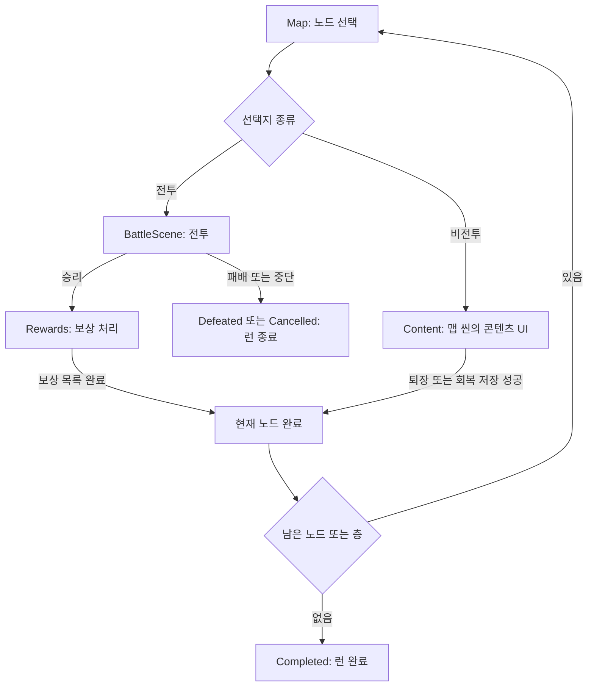

# 맵과 런 진행

정리 기준일: 2026-11-11. 현재 구현과 향후 콘텐츠 노드의 설계를 구분합니다. 강화 세부 설계는 [카드 강화 구현 설계](CardUpgrades.md)를 참고합니다.

## 구현 상태와 역할

맵 생성, 노드 선택, 전투 씬 왕복과 보상 완료 후 진행을 구현했습니다. 상점 입장·진열·카드 상세보기·구매·퇴장과 휴식 체력 회복을 이용할 수 있습니다. 상점 카드 제거·매개체 판매, 휴식 카드 강화, 매개체 보상 노드와 이벤트는 준비 중입니다. 최대 탄약 증가 매개체는 예시 에셋의 보유·적용 기능까지 구현되어 있습니다.

| 구성 | 역할 | 소스 |
|---|---|---|
| `RunDefinition` | 씬 이름, 시작 HP·골드, 층 목록, 허용 콘텐츠 | [RunDefinition.cs](../Assets/Scripts/Map/RunDefinition.cs) |
| `FloorMapDefinition` | 노드 수, 생성 모드, 확률·가중치, 전투 풀과 콘텐츠 데이터 | [FloorMapDefinition.cs](../Assets/Scripts/Map/FloorMapDefinition.cs) |
| `MapGenerator` | 설정과 시드로 한 층의 노드·선택지 생성 | [MapGenerator.cs](../Assets/Scripts/Map/MapGenerator.cs) |
| `MapNode`, `MapChoice` | 노드 규칙·진행 상태와 선택지의 종류·데이터 | [MapNode.cs](../Assets/Scripts/Map/MapNode.cs) |
| `RunProgress` | 현재 층·노드·HP와 진행 단계, 완료 조건 관리 | [RunProgress.cs](../Assets/Scripts/Map/RunProgress.cs) |
| `RunSession` | 씬을 넘어 진행 상태 유지, 전투 이동, 완료 통지 | [RunSession.cs](../Assets/Scripts/Map/RunSession.cs) |
| `MapController` | 맵 UI 갱신, 선택 잠금, 콘텐츠 처리기 호출 | [MapController.cs](../Assets/Scripts/Map/MapController.cs) |
| `MapContentHandler` | 비전투 콘텐츠의 진입, 상태 저장·복원, 방문 검증 공통 계약 | [MapContentHandler.cs](../Assets/Scripts/Map/MapContentHandler.cs) |
| `ShopHandler`, `ShopStockSampler` | 상점 패널과 골드 표시, 슬롯 추첨과 복원, 퇴장 | [ShopHandler.cs](../Assets/Scripts/Map/ShopHandler.cs), [ShopStockSampler.cs](../Assets/Scripts/Map/ShopStockSampler.cs) |
| `RestHandler` | 휴식 패널, HP 표시와 회복 입력 | [RestHandler.cs](../Assets/Scripts/Map/RestHandler.cs) |
| `RunBattleBridge` | 전투 시작 시 런 정보 적용, 결과·보상 완료 전달 | [RunBattleBridge.cs](../Assets/Scripts/Map/RunBattleBridge.cs) |

설정 ScriptableObject는 공유 정의이고, `RunProgress`의 노드 상태와 각 인벤토리가 현재 런의 실행 상태입니다. 상품 구매 여부나 이벤트 선택 결과를 공유 설정 에셋에 기록하지 않습니다.

## 현재 실행 구성

- 빌드 시작 씬은 `TitleScene`입니다. 새 게임을 시작하면 `MapScene`으로 이동하며, `MapScene`을 직접 실행하면 새 런을 구성합니다.
- 런 설정: `Assets/MapData/TemporaryRun.asset`.
- 층 설정: `Assets/MapData/TemporaryFloor.asset`.
- 전투 설정: `Assets/MapData/NormalEncounter.asset`.
- 일반 전투를 5개 지점에 배치합니다. 3번째 지점에서는 일반 전투 또는 상점, 4번째 지점에서는 일반 전투 또는 휴식을 선택할 수 있습니다. 전투 보상 처리, 상점 퇴장 또는 휴식 회복을 완료하면 다음 노드로 이동합니다.
- 다섯 번째 지점의 처리가 끝나면 맵에서 `런 완료`를 표시하고 선택지를 숨깁니다. 앱이나 Unity Play Mode를 강제로 종료하지 않습니다.
- 패배 또는 전투 중단 시 진행을 멈추고 맵에 런 종료 상태를 표시합니다.
- 현재 임시 런은 최대 HP 80, 보유 골드 100으로 시작합니다. 1층 전투의 골드 보상은 노드 시드로 정한 20~25에 현재 노드 번호(1부터 시작)를 더합니다. 첫 노드 보상은 21~26골드입니다. [전투 보상](BattleRewards.md) 참고.

## 규칙 조정

`FloorMapDefinition.mode`는 두 모드를 제공합니다.

| 모드 | 규칙 |
|---|---|
| NormalBattlesOnly | `nodeCount`만큼 일반 전투를 배치합니다. 상점과 휴식이 활성화되어 있으면 각각 `fixedShopNodeNumber`와 `fixedRestNodeNumber` 지점에 해당 선택지를 추가합니다. 위치는 1부터 세며 0은 비활성입니다. |
| PlannedFloor | 첫 일반 전투, 마지막 보스, 중간 특수 전투와 바로 다음 매개체를 예약한 후 나머지 일반 노드를 생성합니다. 최소 4개 노드가 필요합니다. |

`PlannedFloor`의 일반 노드는 항상 일반 전투를 제공합니다. `nonBattleChance`로 추가 비전투 선택지의 등장 여부를 결정하고, `nonBattleContents`의 가중치로 설정된 상점·매개체·이벤트·강화·휴식 중 하나를 고릅니다. `eliteChance`는 엘리트 선택지를 독립적으로 추가합니다. 선택지는 최대 3개입니다.

중간 특수 노드는 `midpointMinRatio`와 `midpointMaxRatio`로 정한 중앙 구간에서 층마다 정확히 한 번 배치합니다. 시작·보스와 충돌하지 않도록 위치를 제한하고, 작은 층에서 비율 구간에 정수 위치가 없으면 가장 가까운 유효 위치를 사용합니다. 이 노드는 일반 전투와 엘리트 전투만 제공하며 어느 쪽을 선택해도 다음 노드는 매개체 하나만 제공합니다. 일반 노드의 확률적 엘리트 선택지는 확정 매개체 규칙과 관계없습니다.

`RunDefinition.floors` 배열의 순서대로 층을 진행합니다. 마지막 노드의 콘텐츠와 보상이 완료되어야 다음 층으로 이동하며, 마지막 층이면 런이 완료됩니다. 층 진입 시 한 번 생성한 결과는 씬을 왕복해도 다시 추첨하지 않습니다. 맵 생성에는 전투·카드 보상과 분리된 `System.Random` 시드를 사용합니다.

정식 층의 노드 수는 아직 결정하지 않았습니다. 클래스의 `nodeCount = 12`는 기본값이며, 현재 임시 에셋은 5로 설정되어 있습니다.

## 노드 선택부터 완료까지

- 선택 전 노드는 `Pending`이며, 선택하면 `Resolving`이 되어 다른 선택을 막습니다.
- 전투는 `Battle → Rewards`를 거칩니다. 카드 선택 후 확인 버튼을 누르는 것은 카드 지급 단계이고, 보상 목록에서 완료하거나 남은 보상을 포기해야 노드가 완료됩니다.
- 비전투는 `Content` 상태에서 처리합니다. 상점은 `상점 나가기`, 휴식은 `체력 회복`이 저장되면 현재 노드를 완료합니다.
- 완료된 노드는 `Completed`가 됩니다. 마지막 노드라면 다음 층을 생성하거나 런을 종료합니다.

## 휴식

휴식 패널은 현재 HP와 최대 HP, 카드 강화와 체력 회복 버튼을 표시합니다. 카드 강화는 `준비 중`으로 표시하며 비활성화되어 있습니다.

체력 회복을 누르기 직전의 `최대 HP - 현재 HP`를 기준으로 30%를 계산합니다. 이 값을 정수로 올림하고 10을 더해 최대 HP까지 회복합니다. 예를 들어 59/80에서는 17을 회복해 76/80이 됩니다. 이미 최대 HP면 체력 변화 없이 휴식을 마칩니다. 비율과 고정 회복량은 `RestHandler`의 Inspector에서 조정할 수 있습니다.

회복과 노드 완료는 함께 저장합니다. 저장에 실패하면 기존 HP와 휴식 패널을 유지하고, 이어서 하기에서 휴식 입장 상태를 복원하면 저장된 HP를 표시합니다.

## 콘텐츠의 연결 경계

콘텐츠가 준비되면 `MapContentHandler`를 상속하는 컴포넌트를 맵 씬에 배치하고 `MapController.contentHandlers`에 연결합니다. `ContentType`은 처리하는 종류이며, `Begin(choice, progress, complete)`에서 화면을 엽니다. 일반 완료 콜백 `complete`는 저장 성공 시 `true`를 반환합니다. 휴식의 체력 회복처럼 자원과 진행을 동시에 바꾸는 동작은 전용 처리로 함께 저장합니다. 콜백에는 런 객체·층·노드가 묶여 있어 오래된 콜백으로 다음 노드나 새 런을 완료할 수 없습니다. `choice.ContentData`로 콘텐츠별 ScriptableObject를 전달할 수 있습니다.

생성 대상은 `RunDefinition.enabledContent`와 실제 사용 가능한 처리기의 교집합입니다. 전투 3종은 기본 처리하며 나머지는 등록된 활성 처리기가 필요합니다. 필수 매개체 처리기가 없는 계획형 층은 런 시작 시 거부합니다. 일반 노드의 미지원 선택지는 생성하지 않습니다. 진행 중 처리기가 비활성화된 경우 해당 선택지는 비활성 상태로 표시됩니다.

계획형 층은 일반·엘리트·보스 전투 풀이 모두 필요합니다. 필수 전투 풀이 비었거나 HP·확률·가중치 설정이 잘못되면 다른 콘텐츠로 대체하지 않고 설정 오류로 알립니다.

## 상점

상점 패널은 왼쪽에 꿈속 상인과 이미지가 적용된 `상점 나가기` 버튼을, 오른쪽에 상품 진열대를 표시합니다. 진열 카드 아래 왼쪽은 매개체 `입고 예정`, 오른쪽은 비활성 `카드 제거` 버튼입니다. 카드 가격은 각 진열 카드 아래 금화 아이콘과 함께 표시합니다. 카드 상세보기에서 `구매`를 누르면 잔액을 확인합니다. 보유 골드가 표시 가격 이상이면 그 가격만큼 차감하고 카드 한 장을 종류에 맞는 런 덱에 추가합니다. 부족하면 상세보기에서 안내하며 골드·덱·진열을 유지합니다. 저장에 실패하면 거래를 되돌리고 상세보기에서 다시 시도할 수 있습니다. 구매한 슬롯은 카드와 가격표를 숨기고 `SOLD OUT` 표지를 표시합니다.

보유 골드는 상단 덱·옵션 버튼 왼쪽에 표시합니다. 골드 아이콘은 문구와 한 줄로 배치해 금액의 자릿수가 바뀌어도 간격을 유지합니다. 덱·옵션 창은 상점 위에서 열리며, 닫으면 상점으로 돌아옵니다. `상점 나가기`는 저장이 성공하면 다음 지점으로 이동하고, 실패하면 패널을 유지합니다.

### 상점 카드 진열

상점은 전투 보상과 같은 `BattleRewardPools` 에셋의 카드 데이터베이스를 사용합니다. 각 슬롯은 아래 분류를 먼저 뽑고 해당 분류에서 카드를 균등하게 고릅니다.

| 슬롯 | 분류별 확률 |
|---|---|
| 꿈 1·2번, 악몽 1번 | 일반 공격, 일반 스킬, 고급 공격, 고급 스킬 각각 25% |
| 꿈 3번, 악몽 2번 | 고급 공격, 고급 스킬, 희귀 공격, 희귀 스킬, 희귀 지속 각각 20% |

일반 카드는 30~40골드, 고급 카드는 60~70골드, 희귀 카드는 90~110골드에서 양 끝을 포함해 균등하게 가격을 뽑습니다. 복원한 진열과 노드 시드로 같은 가격을 재현합니다. 품절 슬롯도 가격 계산 순서에 포함해 다른 슬롯의 가격을 유지합니다.

이미 진열한 카드는 같은 방문에서 다시 뽑지 않습니다. 후보가 없는 분류는 제외하고 남은 분류끼리 같은 확률로 뽑습니다. 현재 꿈 3칸을 사용하며, 악몽 데이터베이스가 비어 있어 악몽 2칸 대신 `입고 예정`을 표시합니다. 진열 카드는 슬롯 순서와 품절 여부를 저장하고 이어서 하기에서 복원합니다. 품절 표지는 입력을 받지 않습니다. 적용 이미지는 [shop-sold-out.png](../Assets/Images/UI/MapScene/shop-sold-out.png), 원본은 [768×240 투명 PNG](../GeneratedArt/UI/ShopSoldOut-v1/shop-sold-out.png)입니다. `DeckCard` 프리팹 인스턴스의 카드는 마우스를 올리면 확대되고, 좌클릭하면 카드 효과와 상태이상 설명을 확인할 수 있습니다.

## 구매·강화·매개체·이벤트의 확장 설계

상점과 휴식처럼 MapScene 안의 패널을 사용합니다. 아래 표는 아직 연결하지 않은 처리와 구성 예시입니다.

| 노드 | 추가할 구성 예시 | 처리와 완료 시점 |
|---|---|---|
| 상점 카드 제거 | 기존 `ShopHandler`와 상점 패널 확장 | 제거할 카드 선택 → 비용 확인·차감과 결과 적용 → 나가기 때 노드 완료 |
| 휴식 카드 강화 | `UpgradeDefinition`, 강화 선택 화면 | 휴식의 카드 강화 버튼 → 런 덱 카드 선택 → 강화 전후 비교 → 확인 후 한 장 교체 |
| 매개체 | `RelicRewardDefinition`, `RelicHandler`, 매개체 선택 패널 | 매개체 후보 표시 → 선택·확인 → 획득 처리 후 노드 완료 |
| 이벤트 | `EventDefinition`, `EventHandler`, 이벤트 패널 | 설명·선택지 표시 → 조건·비용 검증 → 결과 적용 → 이벤트 종료 때 노드 완료 |

### 공통 처리 계약

1. `ContentType`으로 자신의 종류를 알리고, `Begin(choice, progress, complete)`에서 정의 데이터가 필요한 콘텐츠는 `choice.ContentData`의 타입을 검증합니다.
2. 상품·매개체 후보나 이벤트 결과는 필요한 시점에 한 번만 추첨하고 실행 상태에 보관합니다. 상점처럼 `CaptureState()`와 `RestoreState()`로 콘텐츠별 상태를 저장·복원합니다.
3. 미리보기와 선택만으로 골드·덱·HP·매개체를 변경하지 않습니다. 확정 시 현재 런·층·노드, 비용, 선택 대상, 처리 여부를 다시 검증합니다.
4. 확정 처리는 한 번만 적용합니다. 복수 구매가 가능한 상점은 구매 건별로 검증하고, 품절 상품의 재지급을 막습니다.
5. 해당 장소 이용을 마치면 `complete`를 호출합니다. 성공하면 화면을 닫고, 저장에 실패하면 화면을 유지해 다시 시도할 수 있게 합니다.

거래나 획득은 방문을 검증하고 자원·콘텐츠 상태를 함께 저장하는 `CommitAcquisition()` 계약에 연결할 수 있습니다. 계약의 저장 실패 복원과 방문 검증 범위는 [노드 체크포인트](RunCheckpoints.md#비전투-노드-연결)에 있습니다.

### 런 데이터 접근 보완

| 데이터 | 현재 구현 | 추가할 기능 |
|---|---|---|
| 덱 | `RunDeckInventory`가 시작 DB 쌍별 런 덱을 유지합니다. 상점은 `TryAddCard()`로 추가하며, 강화에는 `GetCardSelections()`와 `TryReplaceCard()`가 마련되어 있습니다. | 맵의 카드 제거와 휴식 강화 UI·저장 연결 |
| 골드 | `RunGoldInventory.Gold`, 양수만 받는 `Add()`, 잔액 검증과 차감을 함께 하는 `TrySpend()` | 콘텐츠별 가격 및 보상 규칙 |
| HP | `RunProgress.CurrentHP`, `MaxHP`, `CaptureHealth()`, 휴식 회복 | 휴식 외 HP 변경 규칙과 HP 0이 되는 이벤트의 종료 정책 |
| 매개체 | `RunRelicInventory`가 `AmmoCapacityRelic`의 보유 여부와 최대 탄약 보너스 유지 | 다양한 매개체 정의와 획득·전투 시작·턴 시작 등 적용 시점의 공통 처리 |

맵 처리를 위해 BattleScene의 `DeckController`나 `BattleManager`를 새로 배치하지 않습니다. 런 데이터 기능을 통해 수정하고, 화면은 변경 통지를 받아 갱신하도록 확장합니다. 기존 전투용 `CardEffect`는 `BattleManager`에 의존하므로 이벤트의 비용·결과를 그대로 대체한다고 가정하지 않습니다.

매개체의 정의·효과는 공유 데이터로 두고, 보유 여부와 획득 시 확정된 값은 런 상태로 보관합니다. 중간 특수 노드 다음의 확정 매개체 노드와 일반 노드의 매개체 선택지는 같은 매개체 처리기를 사용할 수 있습니다.

### Inspector와 생성 규칙 연결 순서

1. 처리기와 패널을 만들고, 처리기를 `MapController.contentHandlers`에 등록합니다.
2. **처리기 오브젝트·컴포넌트는 활성 상태로 유지하고, 자식 UI 패널만 숨깁니다.** 현재 코드는 `isActiveAndEnabled`인 처리기만 사용 가능한 콘텐츠로 인식합니다.
3. 각 콘텐츠 정의를 `FloorMapDefinition.nonBattleContents[].contentData`에 연결합니다. 확정 매개체용 정의는 `guaranteedRelicData`에 연결합니다.
4. `RunDefinition.enabledContent`에 종류를 추가합니다. 확률과 가중치는 각각 `nonBattleChance`, `nonBattleContents[].weight`로 조정합니다.
5. `NormalBattlesOnly`에서 고정 상점과 휴식의 위치는 각각 `fixedShopNodeNumber`와 `fixedRestNodeNumber`로 지정합니다. `PlannedFloor` 전환에는 일반·엘리트·보스 전투 풀, 허용 종류, 활성 매개체 처리기가 함께 필요합니다. 상점만 추가해서 기존 계획형 규칙이 곧바로 동작하는 것은 아닙니다.
6. 새 런에서 확인합니다. 생성 허용 종류는 런 생성 시 확정되므로 진행 중 에셋이나 처리기를 수정해도 기존 노드가 자동 재생성되지는 않습니다. 타이틀에서 런을 시작할 때도 지원 콘텐츠 종류를 전달해야 합니다.

카드 제거 비용, 매개체 중복 허용, 강화 횟수와 취소·건너뛰기 정책은 아직 확정하지 않았습니다.

### 콘텐츠 추가 후 확인할 항목 — 예정

- 선택 순간에는 결과가 적용되지 않고, 확정 시 한 번만 반영되는지 확인합니다.
- 골드 부족, 품절, 이미 획득한 매개체, 강화 불가 카드와 취소 경로를 확인합니다.
- 오래된 UI나 중복 콜백이 새 런·다음 노드의 데이터와 진행에 영향을 주지 않아야 합니다.
- 맵에서 반영한 덱·골드·HP·매개체가 다음 전투에 이어지고, 새 런에서는 초기화되어야 합니다.
- 완료 전에는 다음 선택지가 잠기고, 완료 후 정확히 한 노드만 진행해야 합니다.
- 일반 전투 5회 임시 모드와 기존 단독 전투 실행도 유지되어야 합니다.

## 선택 카드 UI

맵의 다음 행동은 화면 중앙 `Canvas/Content/Choices`의 `Horizontal Layout Group`에 배치합니다. 카드는 360×440 크기의 사각형이며, 한 장은 중앙에, 두세 장은 중앙을 기준으로 가로로 나란히 표시합니다. 카드 전체를 클릭하면 기존 노드 선택 동작을 실행합니다.

`MapController` 오브젝트의 **Choice Presentations** 배열에서 노드 종류별 `Artwork`, `Title`, `Description`을 설정합니다. 제목과 설명을 비우면 해당 종류의 기본 문구를 표시합니다. 이미지가 없으면 아트워크 자리 표시를 사용하고, 연결된 이미지는 비율을 유지해서 표시합니다. 현재 일반 전투는 검, 상점은 초승달 금화가 놓인 가죽 주머니, 휴식은 모닥불을 표시합니다. 세 아이콘은 `Assets/Images/UI/NodeIcons/`의 296×196 투명 PNG를 사용합니다.

각 카드의 `MapChoiceCardUI`는 아트워크·제목·설명을 분리해 표시합니다. 카드 내부 이미지와 텍스트는 클릭을 가로채지 않으며 기존 Button의 노드 선택 연결을 유지합니다. 미지원 콘텐츠 선택지는 기존과 같이 비활성화합니다. 현재 런 설정에서는 3번째 지점에 상점 카드, 4번째 지점에 휴식 카드가 함께 표시됩니다.

하단 진행 표시는 고정된 마스크 영역 안에서 세로로 스크롤됩니다. 노드 수가 많아져도 카드·상태 문구와 겹치지 않으며, 현재 노드가 있는 행을 자동으로 표시합니다.

`ProjectDN/Update Map Choice Cards`는 기존 맵의 버튼과 클릭 연결을 보존하면서 이 카드 배치를 적용하는 Editor 도구입니다. `Setup Map System`으로 맵을 새로 구성할 때도 같은 배치를 적용합니다.

## 노드 진입 연출과 씬 전환

선택 가능한 카드에 마우스를 올리면 테두리가 밝아지고 아이콘이 기준 해상도에서 5px 위로 움직입니다. 진입과 이탈은 약 0.15초이며 카드 본체와 클릭 영역은 고정됩니다. 클릭으로 선택이 확정되면 아이콘을 원위치로 돌린 뒤 진입 연출을 시작합니다. 선택한 카드를 강조하는 동안 주변 선택지는 살짝 어둡게 표시합니다.

| 노드 | 새로 진입할 때의 동작 |
|---|---|
| 전투 | 선택 카드를 약 0.15초 강조하고 공용 남청색 안개로 전투 씬에 전환합니다. |
| 상점 | 카드 테두리가 약 0.15초 동안 금빛으로 강조되고 동전 주머니 아이콘이 잠깐 커집니다. 이후 약 0.25초 동안 상점이 나타나며 진열대가 아래에서 올라옵니다. |
| 휴식 | 모닥불 뒤에 주황빛이 번지고 약 0.25초에 걸쳐 휴식 패널이 나타납니다. |

상점·휴식은 맵 안에서 패널을 엽니다. 패널 진입 연출 중에는 해당 패널의 입력을 잠그고, 이어서 하기로 이 노드를 복원할 때는 패널을 즉시 표시합니다.

공용 안개는 타이틀의 `모험 시작` 확정 → 맵, 맵의 전투 선택 → 전투에 사용합니다. 같은 텍스처 두 레이어가 서로 다른 속도로 흐르며 약 0.32초에 화면을 덮습니다. 화면을 가린 채 씬을 로드하고, 다음 씬에서 약 0.38초에 걸쳐 안개를 걷고 입력을 엽니다. 적용 이미지는 [SceneTransitionFog.png](../Assets/Resources/SceneTransitionFog.png), 원본은 [2048×1024 투명 PNG](../GeneratedArt/UI/SceneTransition-v1/scene-transition-fog.png)입니다. 장시간 로딩의 초승달과 안내 문구는 추가 예정입니다.

## 맵 화면과 전투 상단 표시

- `MapScene`은 1층 배경, HP·골드 배지, 전투 선택 카드 프레임을 사용합니다. 진행 목록은 연결선과 완료·현재·대기 노드 마커를 스크롤 영역에 표시합니다. 관련 스프라이트는 `Assets/Images/UI/MapScene/`에 있습니다.
- `Canvas/MapUtilityButtons`의 왼쪽 덱 버튼은 현재 런의 꿈·악몽 보유 덱을 열고, 오른쪽 옵션 버튼은 공용 설정 창을 엽니다. 덱·옵션 창이 열려 있는 동안과 닫은 프레임에는 노드를 선택할 수 없습니다. [전체 덱 보기](DeckOverview.md), [옵션 창](SettingsWindow.md) 참고.
- `BattleScene`의 `TopArea/RunInfo`는 군인 심볼, 현재 층·노드, 보유 골드를 표시합니다. 층·노드는 맵과 같은 `1층 · 2 / 5` 형식을 사용합니다. 골드를 수령하면 상단 보유액이 갱신되고, 단독 전투에서는 층·노드에 `—`가 표시됩니다. 표시 연결은 [`BattleRunInfoUI`](../Assets/Scripts/UI/BattleRunInfoUI.cs)가 담당합니다.

## 상태와 전투 연결

- `MapGenerator`: 화면과 씬에 의존하지 않는 생성 규칙.
- `RunProgress`: 생성 결과, 현재 층·노드, 선택·완료 상태, HP, 런 결과.
- `RunSession`: 씬을 넘어 유지되는 진행 관리자. 기존 `RunDeckInventory`, `RunGoldInventory`, `RunRelicInventory`를 재사용합니다.
- `RunBattleBridge`: 모든 캐릭터의 Awake 이후, BattleManager.Start 이전에 HP와 적·보상 설정을 적용합니다. 전투 결과와 보상 완료를 현재 런에 전달합니다.
- `MapController`: 진행 상황과 선택지 표시, 콘텐츠 처리기 연결.

승리 시 `Battle → Rewards`로 전환하며 `BattleRewardSystem.Completed` 전에는 노드가 완료되지 않습니다. 선택은 즉시 잠기고, 전투 결과·보상 완료·비전투 완료에는 현재 런과 노드 검증을 적용합니다. 패배와 중단은 보상을 생성하거나 노드를 완료하지 않습니다.

HP와 최대 HP는 다음 전투에 복원합니다. 꿈·악몽의 런 덱과 골드·매개체는 유지하며, 패·드로우/버림/소멸 더미·상태이상·지속 카드·지연 효과·탄약과 코스트는 기존 전투별 초기화 규칙을 유지합니다. 데이터베이스와 CardData 원본을 런 상태로 수정하지 않습니다.

활성 런 없이 BattleScene을 직접 실행하면 단독 전투를 시작합니다. 타이틀에서 이어서 하기를 선택하면 최근 체크포인트의 맵, 상점·휴식 입장, 전투 입장 또는 보상 단계로 복귀합니다. [노드 체크포인트와 이어서 하기](RunCheckpoints.md) 참고.

## 타이틀·종료 시퀀스용 진입점

타이틀에서 새 런을 시작하려면 [캐릭터 선택 창](TitleMenu.md#캐릭터-선택)에서 군인을 선택하고 `모험 시작`을 확정합니다. 현재 `TemporaryRun`으로 맵에 진입하며 시작 골드는 100입니다.

- `RunSession.GetOrCreate().StartNewRun(definition, seed, supportedContent)`: 설정을 검증한 뒤 모든 런 인벤토리와 HP·진행을 새로 시작합니다. 맵 씬에서는 등록된 처리기 종류를 전달합니다. 처리기를 전달하지 않으면 전투만 지원하는 것으로 취급합니다.
- `RunSession.RunFinished`: `Completed`, `Defeated`, `Cancelled` 중 결과를 런당 한 번 알립니다. 현재는 종료 상태를 맵에 표시합니다.
- `RunSession.Progress`: 진행·HP·결과 조회.

`ProjectDN/Setup Map System`은 Unity Editor API로 기본 에셋과 씬을 생성하고 전투 연결을 구성합니다. 이미 존재하는 설정값과 맵 UI는 재생성하지 않습니다. 기존 맵에서 런 설정 참조가 누락됐을 때만 기본 설정을 복구합니다.

## 검증

### 2026-11-11 노드 연출·상점 구매·매개체 표기 검증

Unity 6000.0.85f2에서 변경 범위별 EditMode 검사를 실행했습니다. 씬 테스트는 Play Mode에서 실제 화면과 입력을 사용합니다. 아래 결과와 캡처의 경로는 로컬 작업 기록입니다.

| 범위 | 결과 | 로컬 기록 |
|---|---|---|
| 상점 진입, 연출 중 입력 잠금, 상점 복원 | 10/10 통과 | `.utmp/shop-entrance-20261111/final.xml` |
| 휴식 진입, 회복 입력 잠금, 휴식 복원과 상점 회귀 | 10/10 통과 | `.utmp/rest-entrance-20261111/final.xml` |
| 공용 안개의 모험 시작·전투 전환, 맵·저장·타이틀 | 26/26 통과 | `.utmp/scene-fog-20261111/final.xml`, `title.xml` |
| 전투·상점·휴식 카드 호버, 진입 전 원위치, 기존 맵 동작 | 11/11 통과 | `.utmp/map-choice-hover-20261111/settled.xml` |
| 잔액 부족·동일·초과, 저장 실패, 중복 구매 차단, 품절·가격 복원 | 46/46 통과 | `.utmp/shop-purchase-20261111/final.xml` |
| 상점 `매개체` 글꼴, 맵 선택지 문구·배치·생성 | 27/27 통과 | `.utmp/medium-label-20261111/final.xml` |

1280×720 화면에서 휴식의 모닥불 빛과 상점의 품절 표지·`매개체` 문구를 확인했습니다. 캡처는 `.utmp/map-system/map-rest-entrance-glow.png`와 `map-shop-sold-out.png`입니다. 맵 선택 카드의 상점 설명 `둘`과 휴식 제목 `휴`의 글꼴 문제는 작업 목록에 남겨 두었습니다. 호버 검증 초기에는 전투 왕복이 간헐적으로 멈췄고, 원인은 확인되지 않았습니다. 최종 맵 검사 11건은 모두 통과했습니다. 11월 11일 검증은 변경 범위별 실행이며 전체 EditMode 결과와 독립 실행 빌드 검증은 아직 확보하지 않았습니다.

### 2026-11-08 상점·휴식 검증

Unity 6000.0.85f2에서 아래 EditMode 검사를 실행했습니다. 상점·휴식 씬 테스트는 Play Mode에 진입해 실제 맵과 패널을 검사합니다. 결과 파일과 캡처는 로컬 `.utmp/` 기준입니다.

| 범위 | 결과 | 기록 |
|---|---|---|
| 공용 보상 풀과 상점 슬롯 추첨 | 43/43 통과 | `shop-stock-verified.xml` |
| 상점 카드 좌클릭 상세보기와 기존 덱·카드 더미 상세보기 | 14/14 통과 | `shop-inspection-green.xml` |
| 상점·휴식 선택 카드 아이콘, 패널 진입과 기존 연결 | 3/3 통과 | `node-icons-tests.xml` |
| 변경된 휴식 회복량, 저장 실패 복구, 다음 전투 HP | 7/7 통과 | `rest-bonus-green.xml` |
| 상점 골드 아이콘과 문구 간격, 맵 씬 연결 | 2/2 통과 | `shop-wallet-tests.xml` |

1280×720 캡처에서 선택 아이콘과 패널을 확인했습니다. 파일은 `.utmp/map-system/`의 `map-choice-shop-icon.png`, `map-choice-rest-icon.png`, `map-shop-stock.png`, `map-rest-recovery.png`입니다. 상점 선택 카드 설명의 `둘` 글자가 기존 폰트에서 네모로 표시되는 문제를 확인했습니다.

휴식 최초 구현 시 전체 EditMode 검사에서 545/546이 통과했습니다. 단일 전투 테스트가 임시 맵의 고정 상점 설정을 가져와 실패했으며, 테스트용 층을 독립적으로 구성한 뒤 해당 검사와 관련 검사 4/4가 통과했습니다. 전체 결과는 `rest-green.xml`, 수정 후 관련 결과는 `rest-verified.xml`입니다. 이후 변경을 포함한 전체 재검사와 독립 실행 빌드 검증은 수행하지 않았습니다.

### 이전 검증 이력

맵 시스템 최초 구현 시(2026-10-18), Unity 6000.0.77f1에서 전체 EditMode 테스트 **369/369 통과**, 실패·건너뛰기 0개입니다. 컴파일 오류가 없으며, 이 중 맵 관련 테스트는 36개입니다.

생성 규칙, 확률 경계, 시드 독립성, 중복·과거 콜백, 필수 콘텐츠 누락을 검사했습니다. Play Mode에 진입하는 씬 테스트에서는 다섯 번의 실제 전투 왕복, 보상 대기와 완료, HP·덱·골드·매개체 유지, 새 런 초기화, 패배·중단, 단독 전투 실행 및 직렬화 참조를 확인했습니다. 시작·완료 화면을 1280×720으로 렌더링해 텍스트와 버튼 배치도 확인했습니다.

최종 결과: `.utmp/map-system/final-full.xml`, 로그: `.utmp/map-system/final-full.log`. 관련 회귀 테스트는 `.utmp/map-system/regression.xml`의 11/11 통과 결과로도 남아 있습니다. 화면 검수 자료는 `.utmp/map-system/map-start.png`, `map-completed.png`입니다. 실행 파일 빌드는 요청 범위에 포함하지 않았습니다.

선택 카드 UI 변경 후에는 영향 범위의 맵 관련 테스트 **39/39 통과**, 실패·건너뛰기 0개를 확인했습니다. 컴파일 오류와 실행 예외가 없으며, 카드 1·2·3장 중앙 정렬, 이미지·문구 교체, 이미지 제거 시 이전 이미지 정리, 12·21개 노드의 마스크/스크롤 및 현재 노드 표시, 기존 전투 5회 왕복을 검증했습니다. 별도 검토에서 발견한 긴 층의 진행 표시 겹침과 같은 프레임에 노드 수를 연속 변경하는 경우도 회귀 테스트로 검증했습니다. 전체 프로젝트 테스트는 UI 변경 후 다시 실행하지 않았습니다.

UI 변경 검증 결과: `.utmp/map-cards/verified-tests.xml`, 로그: `.utmp/map-cards/verified-tests.log`. 선택지 1·2·3장과 긴 층의 화면도 `.utmp/map-system/map-card-*.png`에 렌더링해 확인했습니다.

2026-11-03에는 관련 테스트로 시작 골드, 맵의 덱·옵션 버튼과 노드 입력 차단, 보상 카드의 맵 덱 반영, 전투 상단의 다음 노드 표시와 골드 수령·저장 실패 시 갱신을 확인했습니다.
